<div align="center">


# Siar

**Write it once. Siar it everywhere.**

One REST API and one dashboard to publish, schedule, reply and measure on 15 social networks.<br />
Unlimited connected accounts, one price per organization.

[siaran.my](https://siaran.my) · [Docs](https://siaran.my/docs) · [API reference](https://siaran.my/docs/api) · [Plan](docs/PLAN.md)


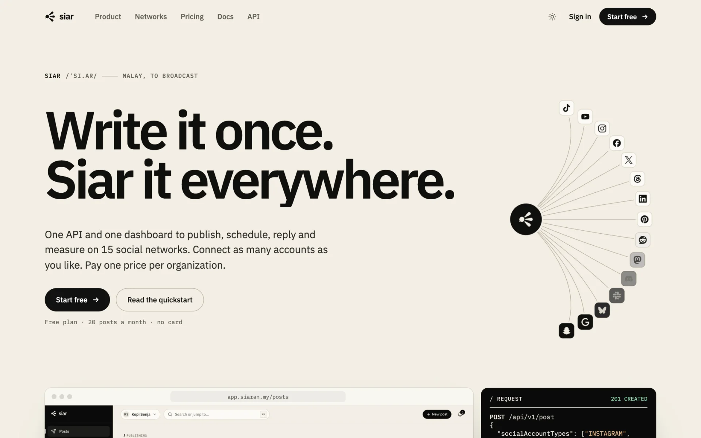

</div>

> *siar* /ˈsi.ar/: Malay, to broadcast. Siar by FF Dev Studio.

---

## Contents

- [What it is](#what-it-is)
- [See it](#see-it)
- [Networks](#networks)
- [The API in one request](#the-api-in-one-request)
- [Plans](#plans)
- [Repository layout](#repository-layout)
- [Getting started](#getting-started)
- [Commands](#commands)
- [Testing](#testing)
- [Screenshots, clips and the share card](#screenshots-clips-and-the-share-card)
- [Deploying](#deploying)
- [Status](#status)
- [Documentation](#documentation)

## What it is

Siar is a unified social media API, wire-compatible with bundle.social's v1 API: same paths under
`/api/v1`, the same `x-api-key` header, field names, enums, error envelope and pagination. An app
that already speaks that API switches by changing its base URL.

| | |
| --- | --- |
| **Publish** | One post, many networks, with per-network text, media and options checked against each network's rules before it is accepted. Scheduling, retries, drafts, review. |
| **Connect** | A hosted connect link with your name on it: customers sign in to each network themselves and land back in your app. Tokens are encrypted and never returned. |
| **Reply** | Comments and DMs from every network in one inbox; reply as the account. |
| **Measure** | Followers, impressions, views, likes and comments per network over time. |
| **Build on it** | REST API (OpenAPI 3.1), TypeScript SDK, JSON-first CLI, MCP server for AI agents, HMAC-signed webhooks with a delivery log and replay. |
| **Run it** | Teams, roles, API keys, quotas, Stripe / CHIP billing with invoices, link-in-bio pages, Google Business locations, Discord and Slack bots. |

## See it

**The composer**: pick the accounts, write once, give Threads its own line, schedule.

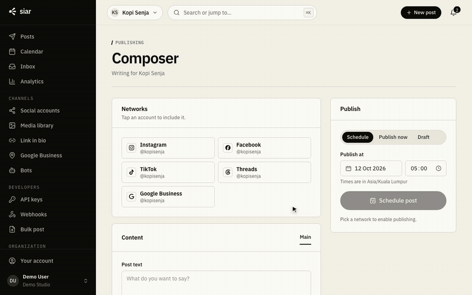

<picture>
  <source media="(prefers-color-scheme: dark)" srcset="apps/site/public/shots/posts-dark.webp" />
  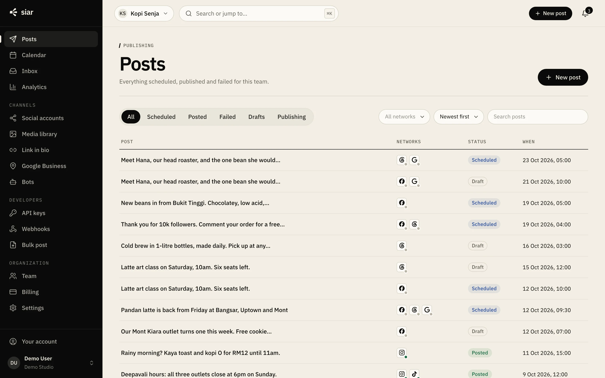
</picture>

| | |
| :---: | :---: |
| 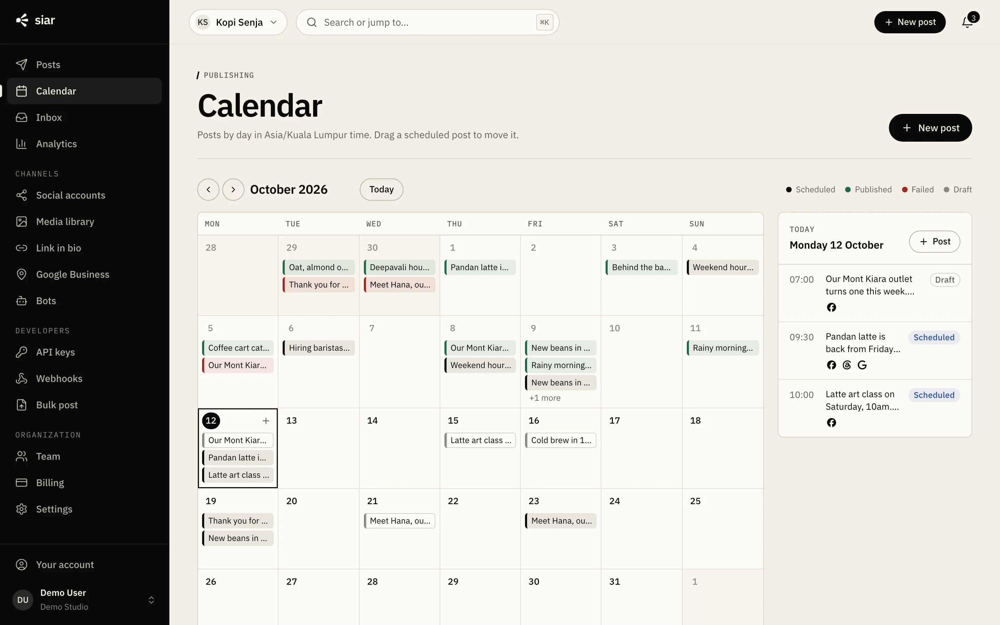 **Calendar**: drag to reschedule, day agenda | 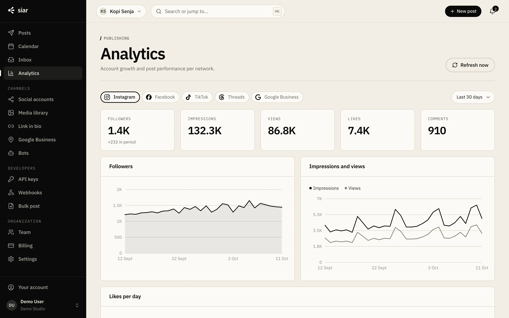 **Analytics**: per network, over time |
| 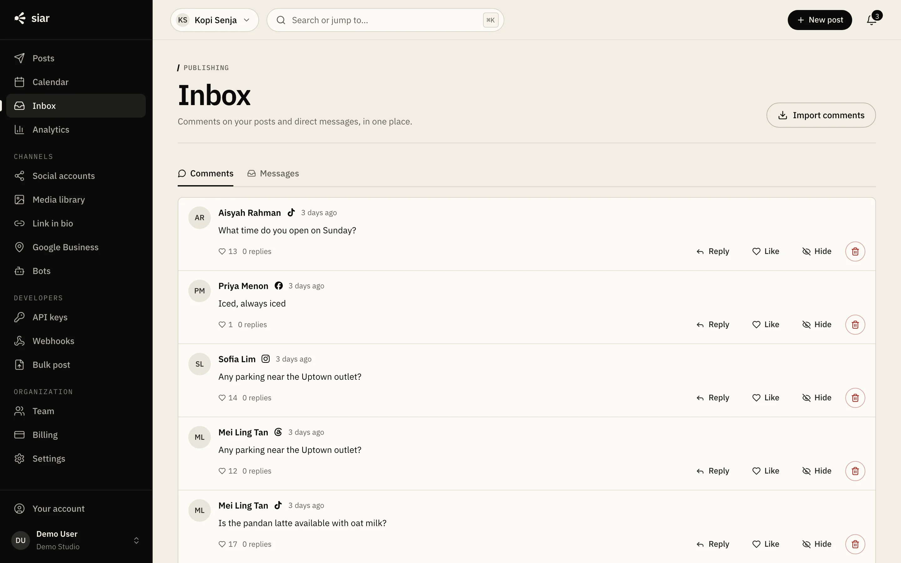 **Inbox**: comments and DMs together | 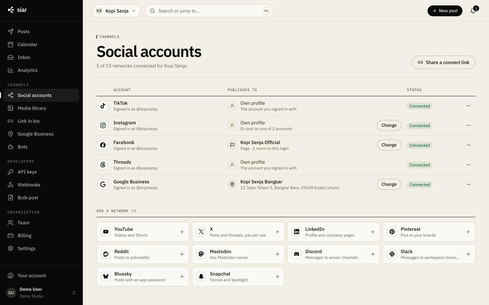 **Social accounts**: status at a glance |
| 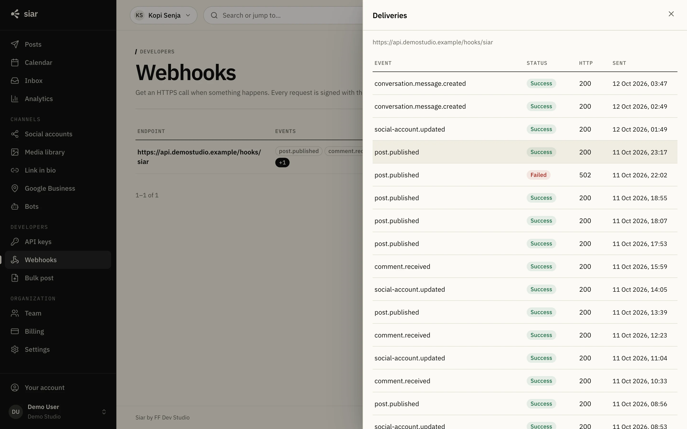 **Webhooks**: delivery log, replay | 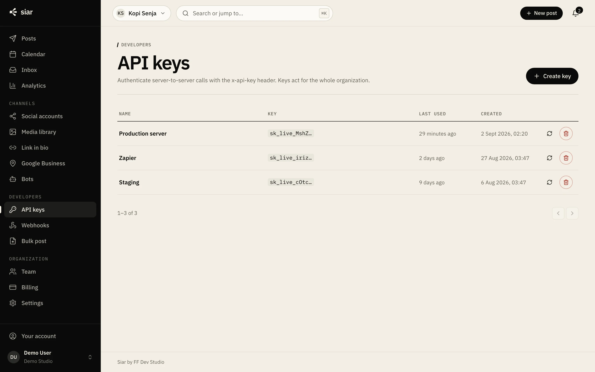 **API keys**: scoped, last used |
| 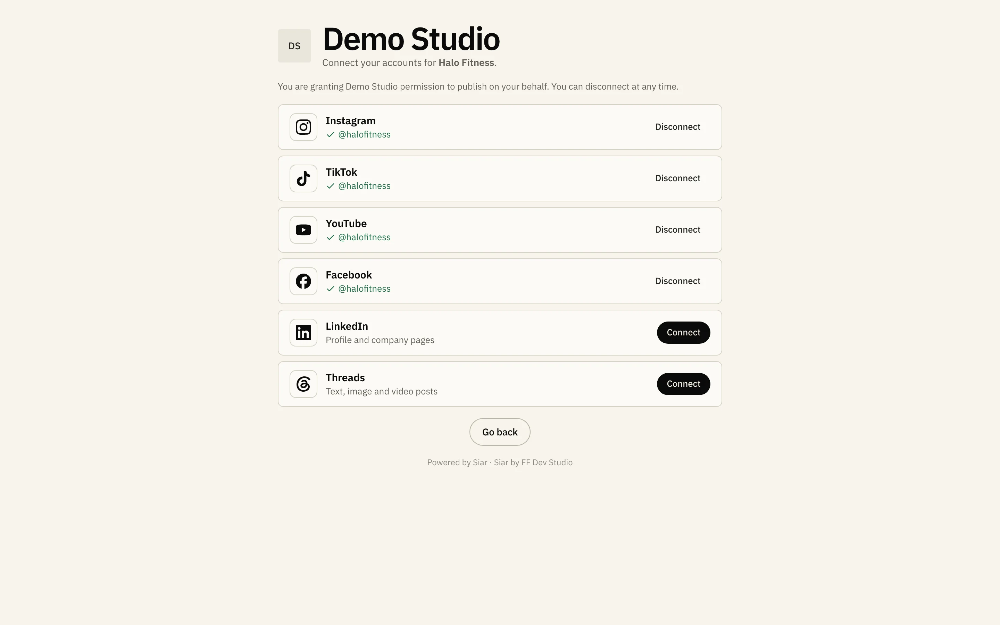 **Hosted connect**: the customer's view | 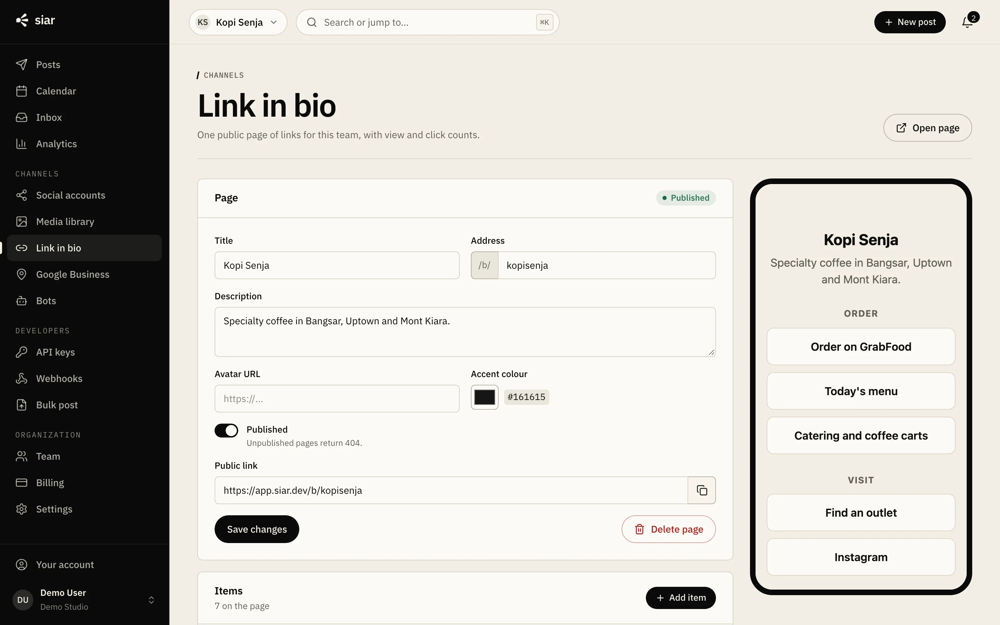 **Link in bio**: views and clicks per link |

All shots and clips are of the real dashboard running the demo seed.

## Networks

| Network | Publishes |
| --- | --- |
| TikTok | Short video and photo posts; privacy options read from the creator first |
| YouTube | Videos and Shorts with title, privacy, audience and disclosures |
| Instagram | Feed posts, carousels, reels and stories (Facebook Login or Instagram Login) |
| Facebook | Page posts, reels and stories |
| X | Posts, threads, polls, quotes, replies; usage passed through at cost from a prepaid credit |
| Threads | Text, image, video and carousel posts, reply controls, topic tags, polls |
| LinkedIn | Member profiles and company pages: text, images, video, documents, links |
| Pinterest | Image and video Pins on a named board |
| Reddit | Text, link and media submissions with flair and NSFW |
| Mastodon | Statuses on any server, with visibility and content warnings |
| Discord | Channel messages from a bot with a per-team name and avatar |
| Slack | Channel messages with files and a custom bot name |
| Bluesky | Posts with images, video, link cards, quotes and labels |
| Google Business Profile | Updates, offers, events, plus reviews, hours, media and menus |
| Snapchat | Stories, Spotlight and saved stories on a public profile |

Each network is one adapter in [`packages/networks/src/adapters`](packages/networks/src/adapters) with a
matching mock server in [`mocks/src/networks`](mocks/src/networks).

## The API in one request

```bash
curl -X POST "https://api.siaran.my/api/v1/post" \
  -H "x-api-key: $SIAR_API_KEY" \
  -H "content-type: application/json" \
  -d '{
    "teamId": "TEAM_ID",
    "title": "Launch day",
    "postDate": "2026-11-02T09:00:00.000Z",
    "status": "SCHEDULED",
    "socialAccountTypes": ["INSTAGRAM", "LINKEDIN", "BLUESKY"],
    "data": {
      "INSTAGRAM": { "type": "POST", "text": "We shipped. Details in the comments.", "uploadIds": ["UPLOAD_ID"] },
      "LINKEDIN":  { "text": "We shipped today. Here is what changed and why.", "uploadIds": ["UPLOAD_ID"] },
      "BLUESKY":   { "text": "We shipped today.", "uploadIds": ["UPLOAD_ID"] }
    },
    "firstComment": { "INSTAGRAM": "Changelog: example.com/changelog" }
  }'
```

The same with the SDK, the CLI and the MCP server:

```ts
import { Siar } from '@siar/sdk';

const siar = new Siar({ apiKey: process.env.SIAR_API_KEY });
const post = await siar.post.create({ teamId, title: 'Hello', postDate: new Date().toISOString(),
  status: 'SCHEDULED', socialAccountTypes: ['BLUESKY'], data: { BLUESKY: { text: 'Hello' } } });
```

```bash
siar posts:create --team team_123 --networks BLUESKY,MASTODON --text "Shipped" --now
```

The MCP server (`siar-mcp`) lets an agent draft, schedule and check posts within the API key's limits.
See [`packages/cli`](packages/cli/README.md) and [`packages/mcp`](packages/mcp/README.md).

## Plans

Billed per organization, never per connected account: every plan connects unlimited social accounts.
Prices are set in ringgit for organizations billed in Malaysia and in US dollars everywhere else
(the billing country decides). Yearly is 10× monthly. Prices, quotas and caps live in
[`apps/api/src/domain/plans.ts`](apps/api/src/domain/plans.ts); the reasoning is in [`docs/pricing.md`](docs/pricing.md).

| | Free | Starter | Pro | Business | Enterprise |
| --- | ---: | ---: | ---: | ---: | ---: |
| Malaysia / month | RM0 | RM39 | RM99 | RM399 | Talk to us |
| Elsewhere / month | $0 | $19 | $49 | $149 | Talk to us |
| Posts | 20, one-time | 300 / month | 10,000 / month | 100,000 / month | 1,000,000 / month |
| Brands (teams) | 1 | 1 | 10 | Unlimited | Unlimited |
| Analytics | | ✓ | ✓ | ✓ | ✓ |
| Free trial | | | 14 days | | |
| Connected accounts | Unlimited | Unlimited | Unlimited | Unlimited | Unlimited |

A subscription renews at the price it started at (price lock). Malaysian yearly plans can be paid
once by FPX or GrabPay and are renewed from a link. Free is a one-time allowance, also counted per
social account so a new organization does not reset it.

## Repository layout

```
apps/
  api/        Fastify 5 + Prisma 7 + Postgres + pg-boss + Redis        :3290
  web/        Vue 3 + Vite dashboard and hosted connect portal          :5290
  site/       Astro marketing site + docs (88 pages)                    :4290
packages/
  contract/   OpenAPI 3.1 document (the contract) + generated TS types
  networks/   One adapter per network behind one interface; no DB
  sdk/        TypeScript SDK
  cli/        JSON-first CLI (`siar`), ships SKILL.md for agents
  mcp/        MCP server (`siar-mcp`)
mocks/        Mock network servers, one per network                      :3299
deploy/       VPS setup and deploy scripts (nginx, pm2)
docs/         Plan, brief, platform approval guides, reference evidence
```

How the pieces hold together:

- **The OpenAPI document is the contract.** Routes are mounted from it and handlers register by
  `operationId`; requests are validated before a handler runs; an operation without a handler answers 501.
- **Tenancy** filters every query by organization; foreign ids are 404.
- **Quotas are atomic**, consumed in the same transaction as the write. **X credit** is a ledger
  (hold → capture | release).
- **Never post twice**: publishing claims each target with a conditional update.
- **Tokens are encrypted** at rest and never logged or returned.

The full rules are in [CLAUDE.md](CLAUDE.md).

## Getting started

**Prerequisites:** Node 22+, pnpm 11, Postgres 16, Redis, ffmpeg (media probing).

```bash
pnpm install
cp apps/api/.env.example apps/api/.env      # set SESSION_SECRET and ENCRYPTION_KEY
createdb siar
pnpm db:migrate
pnpm db:seed                                 # demo org "Demo Studio", 4 teams, 160 posts
```

Run the four servers (each in its own terminal):

```bash
pnpm --filter @siar/mocks dev
```

```bash
pnpm dev:api
```

```bash
pnpm dev:web
```

```bash
pnpm dev:site
```

| Server | URL |
| --- | --- |
| Dashboard | http://localhost:5290 (demo login `demo@siaran.my`, password in [`apps/api/prisma/seed.ts`](apps/api/prisma/seed.ts)) |
| API | http://localhost:3290/api/v1 |
| Site + docs | http://localhost:4290 |
| Mock networks | http://localhost:3299 |

In development every network call goes to the mocks (`NETWORK_MODE=mock`) and billing runs in mock
mode, so nothing reaches a real network or card.

## Commands

| Command | What it does |
| --- | --- |
| `pnpm build` | Build every package and app |
| `pnpm typecheck` | Typecheck every package and app |
| `pnpm test` | Adapter tests (networks) and SDK tests; the API is covered by e2e |
| `pnpm contract` | Rebuild the OpenAPI document and types after an overlay edit |
| `pnpm db:migrate` / `pnpm db:seed` | Apply migrations / reset the demo org |
| `pnpm --filter @siar/api e2e` | End-to-end checks against the running API and mocks |
| `cd apps/api && npx tsx --env-file=.env scripts/coverage.ts` | Operations with a handler, per tag |
| `bash scripts/check-type.sh` | Type scale check: whole pixels, nothing under 11px |

## Testing

| Suite | Result (2026-10-12) |
| --- | --- |
| API operations implemented | 262 / 262 |
| End-to-end checks (`apps/api/scripts/e2e.ts`) | 38 / 38 |
| Network adapter tests (against in-process mocks) | 52 / 52 |
| SDK tests | 31 / 31 |
| Typecheck (`pnpm typecheck`) | every package, clean |
| Site build | 88 pages + the share card, clean |

## Screenshots, clips and the share card

Everything visual on the site comes from the running product. Reseed before and after, since two of
the scripts write demo data.

| Asset | Command | Output |
| --- | --- | --- |
| Dashboard screenshots | `node apps/site/scripts/shots.mjs [scene…]` | `apps/site/public/shots/*.webp` |
| Walkthrough recordings | `node apps/site/scripts/clips.mjs [clip…]` | `apps/site/public/clips/*.mp4` + posters |
| Share card (1200×630) | `node apps/site/scripts/og.mjs` | `apps/site/public/og.png` |

The `flow` shot scene and the clips schedule a post and connect an account in the demo org.

## Deploying

One Ubuntu VPS behind Cloudflare: nginx, the API and worker under pm2, Postgres 16, Redis and ffmpeg on the box.
Domains: `siaran.my`, `www`, `app`, `api`, `media`. Steps in [`deploy/README.md`](deploy/README.md).

Each network needs its developer app approved before real accounts can connect. The checklist is
[`docs/approvals/README.md`](docs/approvals/README.md), with one guide per network.

> Nothing deploys, publishes to npm, posts to a real account, charges a real card or emails a real
> customer without an explicit go from Fakhrul.

## Status

**Built end to end against mock networks. Not deployed.**

- [x] API: all 262 operations, quotas, credits, webhooks, billing, invoices
- [x] 15 network adapters with mocks and tests
- [x] Dashboard, hosted connect, link-in-bio, notifications, ⌘K palette
- [x] Marketing site and docs: home, product tour, networks, pricing, use cases, API reference
- [x] SDK, CLI, MCP server
- [ ] Network app approvals (Track B, [`docs/approvals`](docs/approvals/README.md))
- [ ] DNS for siaran.my, VPS, deploy
- [ ] Legal review of terms and privacy
- [x] Final plan prices (localized, 2026-10-13: docs/pricing.md)

Spec audit 2026-10-12: every adapter checked against the networks' current docs (LinkedIn on
202609, Snapchat rewritten for the Public Profile API, Meta/TikTok/Google/Reddit field and scope
fixes). Still unproven until each network's app is approved: a live connect + publish per network.
Bluesky OAuth is a public client (2-week sessions); Snapchat image limits are unconfirmed.

## Documentation

| Document | For |
| --- | --- |
| [docs/PLAN.md](docs/PLAN.md) | The build plan and every decision behind it |
| [docs/brief.md](docs/brief.md) | Scope, identity, what is not being built |
| [CLAUDE.md](CLAUDE.md) | Working rules: contract, tenancy, quotas, look, scripts |
| [docs/approvals](docs/approvals/README.md) | Network developer-app approval guides |
| [deploy/README.md](deploy/README.md) | Server setup and deploy |
| [docs/reference](docs/reference/2026-10-11) | Reference evidence (bundle.social, 2026-10-11) |

---

<div align="center">

**Siar** by FF Dev Studio · FF DEV STUDIO (202603234793), Malaysia<br />
Proprietary. All rights reserved.

</div>
